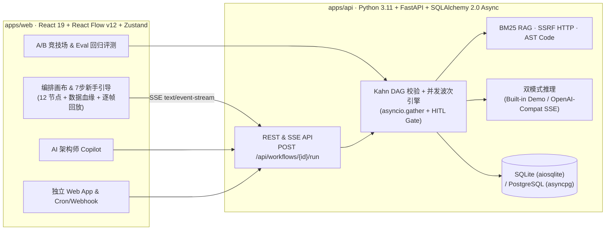

# SynthFlow Pro — AI 智能体与可视化工作流编排引擎

> 对标 Dify Pro / n8n / Coze 的全栈可视化 AI Agent 工作流编排工作室。前端采用 **React 19 + TypeScript + React Flow v12 + Zustand**，后端采用 **Python 3.11 + FastAPI + SQLAlchemy 2.0 Async + 异步 DAG 波次调度引擎 + SSE 逐节点实时推流**。默认开箱即享免 Key 高拟真演示推理，同时一键切换真实 OpenAI / DeepSeek / Qwen / OpenRouter / 本地 Ollama 大模型。

---

## 核心旗舰亮点

- **12 种企业级功能节点**：`Input`、`Knowledge RAG (BM25)`、`LLM Agent`、`Condition`、`Intent Classifier（多路零样本路由）`、`HTTP Tool（SSRF 防护 + 安全沙箱）`、`Code Transform（AST 白名单表达式/JSON 提取）`、`Aggregator（多路汇聚）`、`Loop / Batch（批量循环）`、`Human Approval（HITL 实时挂起/在线改稿/放行）`、`Sticky Note（架构便签）`、`Output`。
- **9 套预置商业工作流模板 + 3 份企业知识库**：涵盖商业竞品深度研报、多平台营销工坊、合同条款风险审查、客户工单分诊、AI 架构与安全审查、3 路意图客服中台、实时行情财经研报、跨境多站点 Listing 工厂、以及 **HITL 高危法务与付款人工审批流**。
- **AI 架构师（Text-to-DAG Copilot）& 架构优化器**：自然语言一句话自动合成多分支可执行 DAG；一键注入质量复核官节点；一键导出 Mermaid 架构图。
- **五大平台级专业工作区**：
  1. **编排画布（Studio）**：数据血缘高亮、单节点独立试跑、右键菜单、`Ctrl+K` 命令面板、历史运行画布逐帧回放时间轴、7 步聚光灯交互式新手引导。
  2. **A/B 竞技场（Arena）**：同一工作流并行跑两套 Model / Temperature / Prompt Patch 变体，自动 4 维打分并裁决胜者。
  3. **自动化评测（Eval Studio）**：基于 `contains` / `branch_taken` / `min_length` / `max_latency_ms` / `no_errors` 断言的自动化回归测试集与一键生成基线用例。
  4. **可观测大盘（Analytics）**：成功率、平均延迟趋势柱状图、节点类型性能分布与 Token 成本估算。
  5. **发布与 API（Deploy & Automation）**：客户视角的独立 Web App 交互预览、cURL / Python `httpx` / TypeScript `fetch` SSE 接入代码、定时 Cron 调度与 Webhook 实时触发器。
- **版本快照 & 可视化 DAG Diff**：随时发布版本检查点，查看 `+ 新增 / - 删除 / ~ 参数变更` 差异并一键回滚。
- **企业级安全设计**：Fernet 对称加密存储 API Key（接口仅返回脱敏掩码 `sk-****89ab`）、HTTP Tool 严格 SSRF 内网/回环/元数据拦截、Code 节点 AST 白名单沙箱。

---

## 系统架构图



---

## 本地一键启动（零配置免 Key 体验）

```bash
# 1. 启动后端 FastAPI (http://127.0.0.1:8000/docs)
cd apps/api
python -m venv .venv
# Windows: .venv\Scripts\activate   |   macOS/Linux: source .venv/bin/activate
pip install -r requirements.txt
uvicorn app.main:app --reload --port 8000

# 2. 启动前端 React Flow Studio (http://127.0.0.1:5173)
cd apps/web
npm install
npm run dev
```

## Docker Compose 一键部署（PostgreSQL + FastAPI + Nginx SSE）

```bash
cp .env.example .env
docker compose up --build -d
# 访问 http://localhost:8080
```

## 自动化测试

```bash
# 后端 33 项单元测试与集成测试
cd apps/api && .venv/Scripts/python -m pytest -v

# 前端 TypeScript 检查与生产构建
cd apps/web && npx tsc --noEmit && npm run build
```
